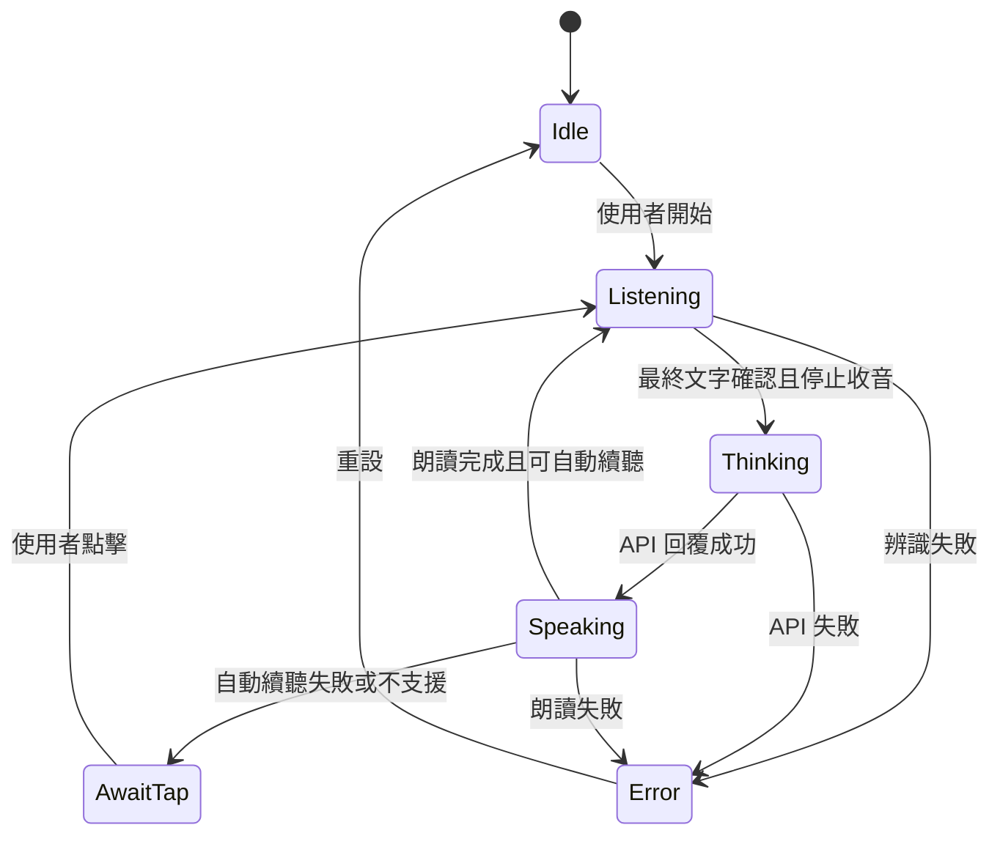

# Socrates Voice AI：iPhone 語音對話網頁開發規格書

版本：1.0｜目標：交由 Codex 完整實作、測試及部署至 GitHub Pages

## 1. 專案目標

建立手機優先的蘇格拉底語音 AI 助手。使用者以 iPhone Safari 開啟網頁、輸入自己的 Gemini API Key，即可透過手機麥克風說話，將辨識文字交給大模型，再由手機朗讀回覆。畫面呈現黑底蘇格拉底卡通動畫，提供近似自然語音對話的體驗。預設採蘇格拉底式引導提問，而非直接提供答案。

## 2. 技術架構與限制

- 純前端靜態網站，使用 HTML、CSS、JavaScript ES Modules；不需要自建後端、資料庫或付費語音 API。
- GitHub Pages 提供 HTTPS；使用相對路徑以支援 repository 子路徑部署。
- STT：Web Speech API，使用 `window.SpeechRecognition || window.webkitSpeechRecognition`。
- TTS：`window.speechSynthesis` 與 `SpeechSynthesisUtterance`。
- LLM：Google Gemini Developer API，透過 fetch 直接呼叫；預設模型 `gemini-flash-lite-latest`，允許使用者修改模型 ID。實作時確認模型可用性、API 文件及瀏覽器 CORS 支援。
- 網頁無法直接控制 iOS 鍵盤聽寫功能；Web Speech API 也不保證完全在手機端離線執行，語音辨識可能使用 Apple 或瀏覽器的遠端服務。
- iOS Safari 的辨識權限、使用者手勢、自動續聽及背景執行均需實機驗證。不可承諾全雙工、背景常駐或鎖屏對話。

## 3. 使用者介面

- 黑色背景，中央為蘇格拉底卡通人像，適應直向及橫向螢幕。
- 頂部設定：API Key（密碼欄位、顯示/隱藏、清除）、模型 ID、語言、聲音、朗讀速度、對話模式。
- 主畫面顯示狀態：待命、聆聽中、思考中、說話中、暫停、錯誤。
- 大型開始/停止按鈕；另提供按一下說話、停止朗讀、重試、清除對話。
- 顯示辨識中的文字、最終辨識文字及 AI 回覆；提供手動輸入、修改與送出。
- 預設繁體中文 `zh-TW`，支援英文 `en-US`；可切換語音辨識及朗讀語言。
- 支援 safe-area-inset、動態視窗高度、44px 以上觸控區域、ARIA 標籤與 reduced-motion。

## 4. 半雙工語音狀態機



任何狀態均可由停止按鈕回到 Idle。

1. 使用者點擊開始，初始化語音功能並取得必要權限。
2. 設定 recognition.lang、interimResults=true、continuous=false；暫時結果只顯示，不送 API。
3. 收到最終結果後去除空白，停止辨識，等待 onend 後才呼叫模型。每輪只提交一次，防止重複事件。
4. 呼叫 Gemini，顯示思考中；使用 AbortController 支援取消與 45 秒逾時。
5. 取得回覆後先確認麥克風辨識已停止，再執行 TTS。
6. TTS onend 後等待約 300–500ms，若仍在自動對話模式且頁面可見，嘗試重啟辨識。
7. 若 Safari 拒絕自動重啟、發生 not-allowed 或沒有開始事件，切換為 AwaitTap，顯示「點一下繼續說話」。不得無限重試。
8. 停止時 abort recognition、abort fetch、speechSynthesis.cancel()，清除排程並以 session/turn ID 忽略過期回呼。

避免喇叭聲音被麥克風重新辨識。初版不實作使用者說話即打斷 AI 的全雙工功能，但可手動停止朗讀後重新收音。

## 5. Gemini API 整合

- Endpoint：`POST https://generativelanguage.googleapis.com/v1beta/models/{model}:generateContent`
- Headers：`Content-Type: application/json`、`x-goog-api-key: <使用者輸入的金鑰>`。
- Body：`systemInstruction`、`contents`（user/model 交替）、`generationConfig`。
- 預設保留最近 10 輪對話，限制輸入長度與輸出 token（建議 512），避免成本失控。
- 從 `candidates[].content.parts[].text` 取得文字；處理空回覆、安全阻擋、非 JSON、網路失敗及 400/401/403/404/429/5xx。
- 429 顯示配額或頻率限制；不得無限重試或偷偷切換模型。允許使用者手動重試。
- 初版採完整文字回覆後朗讀，不使用串流，降低 Safari 相容性與語音排程複雜度。

### 預設 System Prompt

```text
你是一位蘇格拉底式 AI 家教。以使用者選定的語言回覆，預設使用台灣繁體中文。
透過引導式問題幫助使用者釐清概念、假設、證據及推理，不急於提供完整答案。
每次先簡短回應使用者的想法，再提出一個清楚且具體的問題。
語氣自然，適合口語朗讀，每次原則上 50 至 150 個中文字，避免 Markdown、網址及冗長條列。
若使用者要求直接解釋，應提供適當說明，不必強制反問。
不確定時明確承認，不捏造資訊。
```

提供一般對話模式及蘇格拉底模式；切換時清除或經使用者確認後重設對話上下文。

## 6. 手機語音朗讀

- 透過 getVoices() 及 voiceschanged 更新聲音清單；優先 zh-TW，再選其他中文聲音，最後使用系統預設。
- rate 預設 0.9，提供 0.7–1.2 調整；pitch 預設 1.0。
- 朗讀前移除 Markdown 格式及不必要的 URL，保留原始回覆供畫面顯示。
- 長文按句切分，依序朗讀；只有最後一段 onend 才觸發續聽。
- 若 TTS 不可用或 onerror，保留文字並提供手動朗讀/繼續對話。設定合理 watchdog 防止卡在 Speaking。
- 進入背景或鎖屏時停止本輪語音工作，返回前景後由使用者手動恢復。

## 7. 蘇格拉底動畫

### 視覺要求

黑色背景、古希臘蘇格拉底卡通半身或頭像、白色鬍鬚、自然表情。動作緩慢，以看向前方為主，偶爾眨眼、微幅頭部運動及短暫左右看。避免誇張表情與快速晃動。

建議主循環 18–30 秒，約 80% 時間看前方；首尾姿態相近，無明顯跳接。此時長為開發預設，可依素材調整。

| 狀態 | 動畫 | 輔助提示 |
|---|---|---|
| Idle / AwaitTap | idle.mp4：自然眨眼、看前方 | 待命文字 |
| Listening | listening.mp4：專注看前方 | 麥克風狀態指示 |
| Thinking | thinking.mp4：輕微轉頭或沉思 | 緩慢呼吸式提示 |
| Speaking | speaking.mp4：自然嘴部運動 | 說話狀態指示 |
| Error | idle.mp4 或 poster.png | 錯誤與重試按鈕 |

- 動畫使用 `<video muted playsinline loop autoplay>`，MP4 H.264、無音軌，建議 480p–720p、24fps，黑底與頁面一致。
- 若只有一段原始動畫，所有狀態共用 idle.mp4，透過 CSS 狀態提示區分；不得假裝已具備精確嘴型同步。
- 可使用 SVG/CSS 自製簡單蘇格拉底替代人像與眨眼動畫，作為缺少影片時的可運作備援。
- 影片載入失敗或 autoplay 被阻擋時，顯示靜態 poster；不得影響語音流程。
- 若提供 GIF，可作備援，但優先 MP4 以降低檔案大小與耗電。
- 本規格書不包含實際動畫影片，需另行加入素材。Codex 必須在沒有外部素材時仍交付可運作版本。

## 8. 安全與隱私

- API Key 預設只存於 JavaScript 記憶體，重新整理即清除；可選擇 sessionStorage，預設關閉，不使用 localStorage 永久保存。
- 不將金鑰寫入 Git、URL、console、錯誤訊息或分析服務；只透過 HTTPS 傳給 Gemini 官方 API。
- 純前端無法完全隱藏 API Key，瀏覽器擴充套件、XSS、共享裝置等仍有風險。提醒使用者設定適當 API 限制、配額及費用監控。
- 不使用第三方 CDN、追蹤器或外部腳本；模型回覆以 textContent 渲染，不直接插入 HTML。
- 語音辨識文字及對話會送往模型服務；辨識本身可能由遠端服務處理。首次使用前顯示告知與同意，不主動錄製或保存音訊。
- 清除對話時清除本機上下文；不能宣稱可刪除外部服務已處理的資料。

## 9. 專案目錄

```text
/
  index.html
  css/app.css
  js/app.js
  js/state-machine.js
  js/speech-recognition.js
  js/speech-synthesis.js
  js/gemini-client.js
  js/avatar.js
  js/settings.js
  assets/socrates/idle.mp4
  assets/socrates/listening.mp4
  assets/socrates/thinking.mp4
  assets/socrates/speaking.mp4
  assets/socrates/poster.svg
  tests/
  README.md
  .gitignore
  .nojekyll
```

影片為選用素材，缺少時必須正常運作。README 說明 API Key 取得方式、部署、素材替換、隱私及 iOS 限制。

## 10. 部署

1. 建立 GitHub repository，提交靜態檔案，不提交任何真實金鑰。
2. Settings → Pages → Deploy from a branch → main / root。
3. 確認 HTTPS 與 repository 子路徑資源載入正常。
4. 以 iPhone Safari 開啟 Pages 網址，實測麥克風權限、語音辨識、朗讀與連續對話。
5. 如需本機測試，使用 localhost 靜態 HTTP server；不可直接依賴 file://。

## 11. 測試與驗收

| 項目 | 通過條件 |
|---|---|
| 部署 | GitHub Pages HTTPS 正常載入，無後端依賴 |
| 金鑰 | 可輸入、清除、錯誤提示，無意外持久化或外洩 |
| STT | iPhone 可辨識中文與英文，暫時結果不重複送出 |
| LLM | 真實 Gemini API 可完成多輪對話 |
| TTS | 手機可朗讀回覆，支援停止及速度設定 |
| 半雙工 | AI 朗讀期間不啟動辨識，不產生自我回授 |
| 自動續聽 | 實機嘗試連續 10 輪；若系統限制，能可靠切換手動續聽 |
| 取消 | 收音、API 等待、朗讀各階段皆可停止，無過期回覆 |
| 動畫 | 循環、狀態提示與素材缺失備援正常 |
| 錯誤 | 權限拒絕、離線、無聲音、無效金鑰、429、逾時皆可恢復 |
| 相容性 | Safari 不支援辨識時可手動輸入；不支援 TTS 時可閱讀文字 |
| 背景 | 切換分頁或鎖屏後不殘留收音，回前景可手動恢復 |

單元測試以 mock recognition、speechSynthesis、fetch 驗證狀態轉移、取消、重複事件及錯誤恢復；瀏覽器自動化測試不能替代 iPhone 實機語音驗證。記錄實際測試裝置、iOS 版本、Safari 版本與結果，未測項目標為未驗證。

## 12. Codex 執行指令

請依本規格直接完成可部署的完整網站，不只提供架構或示範程式。先檢查 repository 現況與現有素材，保留既有檔案，依模組實作全部核心功能、測試及 README。若 API 或瀏覽器能力與規格假設不同，採可用備援並記錄原因。不得虛構實機測試結果，不得將真實 API Key 寫入專案。完成後列出實作功能、測試結果、尚需 iPhone 實機驗證的項目及 GitHub Pages 部署步驟。
